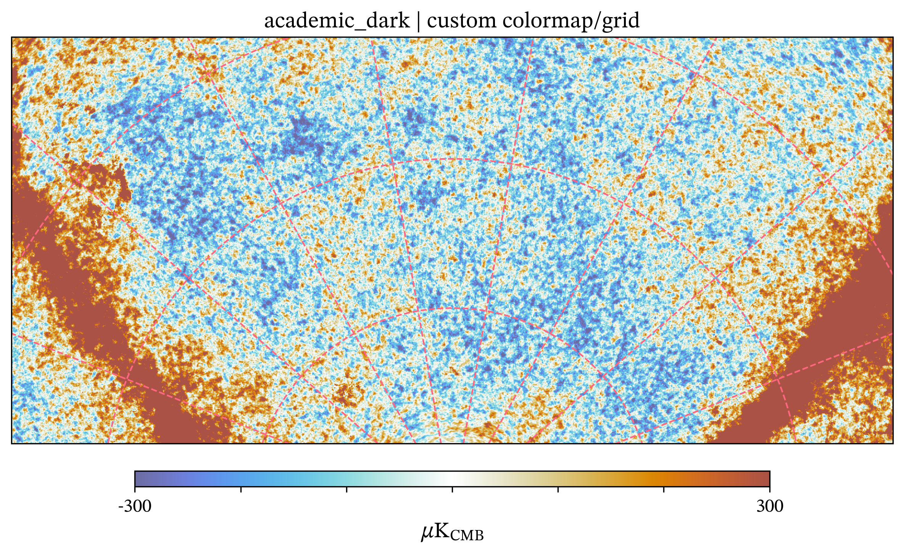
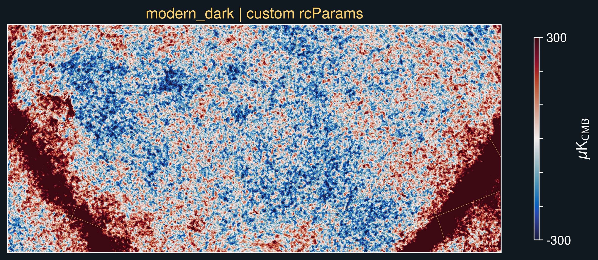
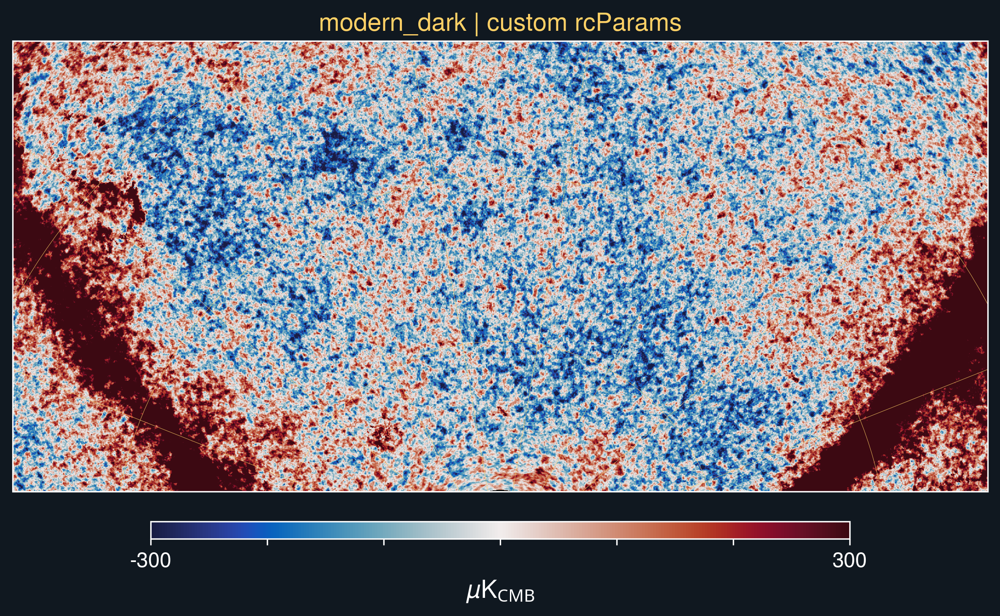

Themes
======

SkyPlot provides ``academic``, ``classic``, and ``modern`` themes, each with a
``_dark`` variant. Importing SkyPlot selects ``modern``. Call ``set_theme`` to
change Matplotlib's settings for subsequent SkyPlot and ordinary Matplotlib
figures. The dark variants use white text, spines, and gridlines on a black
background.

.. list-table:: Theme defaults
   :header-rows: 1
   :widths: 20 45 35

   * - Theme
     - Text / math fonts
     - Default colormap
   * - ``academic``
     - STIX Two Text / STIX Two Math
     - ``planck``
   * - ``classic``
     - EB Garamond / Garamond-Math
     - ``w_ymiddle1``
   * - ``modern``
     - TeX Gyre Heros / Noto Sans Math
     - ``balance``

Each dark variant keeps the same font pair and colormap as its light theme.
All six styles are shown below using the same NPIPE 143 GHz map, projection,
and color limits from the `theme showcase notebook
<https://github.com/1cosmologist/skyplot/blob/main/notebooks/theme_showcase.ipynb>`__.

Academic
--------

.. list-table:: Academic theme, light and dark
   :header-rows: 1
   :widths: 50 50

   * - Light
     - Dark
   * - .. image:: figures/academic.png
          :alt: NPIPE map with the academic theme and planck colormap.
          :width: 100%
     - .. image:: figures/academic_dark.png
          :alt: The same NPIPE map with the academic dark theme.
          :width: 100%

Classic
-------

.. list-table:: Classic theme, light and dark
   :header-rows: 1
   :widths: 50 50

   * - Light
     - Dark
   * - .. image:: figures/classic.png
          :alt: NPIPE map with the classic theme and w_ymiddle1 colormap.
          :width: 100%
     - .. image:: figures/classic_dark.png
          :alt: The same NPIPE map with the classic dark theme.
          :width: 100%

Modern
------

.. list-table:: Modern theme, light and dark
   :header-rows: 1
   :widths: 50 50

   * - Light
     - Dark
   * - .. image:: figures/modern.png
          :alt: NPIPE map with the modern theme and balance colormap.
          :width: 100%
     - .. image:: figures/modern_dark.png
          :alt: The same NPIPE map with the modern dark theme.
          :width: 100%

Try the themes with your own map
--------------------------------

The gallery uses the notebook's NPIPE data. The following code creates a small
HEALPix map so you can run the theme examples without a data file. Replace
``sky_map`` with your own HEALPix array when ready.

.. code-block:: python

   import healpy as hp
   import matplotlib as mpl
   import matplotlib.pyplot as plt
   import numpy as np

   import skyplot as sp

   nside = 32
   theta, phi = hp.pix2ang(nside, np.arange(hp.nside2npix(nside)))
   sky_map = (
       0.65 * np.cos(2 * theta)
       + 0.35 * np.sin(theta) ** 2 * np.cos(3 * phi)
       + 0.18 * np.sin(5 * phi + theta)
   )

   def make_plot(title, **plot_options):
       return sp.equidistantconic(
           sky_map,
           projection_kwargs={
               "central_longitude": 15.0,
               "central_latitude": -45.0,
               "standard_parallels": (-70.0, -15.0),
           },
           extent=(-90.0, 120.0, -65.0, -5.0),
           n_theta=120,
           n_phi=240,
           vmin=-1.2,
           vmax=1.2,
           title=title,
           colorbar_title="Synthetic signal",
           **plot_options,
       )

Use ``mpl.rc_context()`` to restore the previous Matplotlib settings after
each plot. Omit ``cmap`` to use the selected theme's default.

.. code-block:: python

   for name in (
       "academic", "academic_dark",
       "classic", "classic_dark",
       "modern", "modern_dark",
   ):
       with mpl.rc_context():
           sp.set_theme(name)
           plot = make_plot(name)
           plot.figure.savefig(f"{name}.png", dpi=150, bbox_inches="tight")
           plt.close(plot.figure)

Customize one plot
------------------

Pass ``cmap`` and ``gridline_kwargs`` to override those choices for a single
plot. The remaining settings come from the selected theme.

.. code-block:: python

   with mpl.rc_context():
       sp.set_theme("academic")
       plot = make_plot(
           "Academic with custom map colors",
           cmap="prinsenvlag_r",
           gridline_kwargs={
               "color": "#ff6680",
               "linewidth": 1.0,
               "linestyle": "--",
           },
       )
       plot.figure.savefig("custom_cmap-grid.png", dpi=150, bbox_inches="tight")
       plt.close(plot.figure)

   The ``prinsenvlag_r`` colormap and pink gridlines override the academic
   defaults for this plot.

Customize Matplotlib settings
-----------------------------

After selecting a theme, change individual ``rcParams`` to affect subsequent
plots. The context below keeps these changes local. ``colorbar_kwargs`` passes
options to Matplotlib's colorbar; ``location="right"`` makes it vertical.

.. code-block:: python

   with mpl.rc_context():
       sp.set_theme("modern_dark")
       mpl.rcParams.update({
           "axes.titlecolor": "#ffd166",
           "grid.color": "#ffd166",
           "figure.facecolor": "#101820",
           "savefig.facecolor": "#101820",
       })
       plot = make_plot(
           "Modern dark with custom settings",
           colorbar_kwargs={"location": "right", "shrink": 0.6},
       )
       plot.figure.savefig("custom_rcparams-cbar.png", dpi=150, bbox_inches="tight")
       plt.close(plot.figure)

   The modern dark colormap stays in place while the title, gridlines,
   background, and colorbar position change.

To keep the horizontal colorbar, omit ``colorbar_kwargs`` in the preceding
example.

   The same Matplotlib overrides with the default horizontal colorbar.
