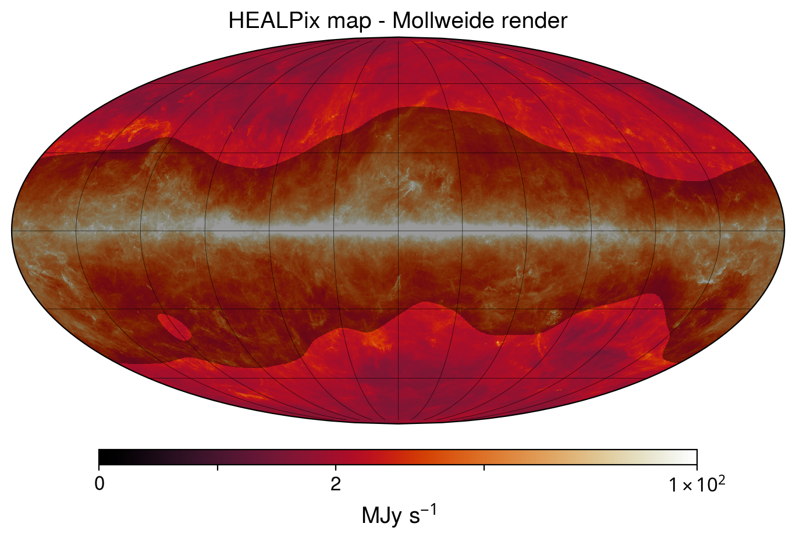
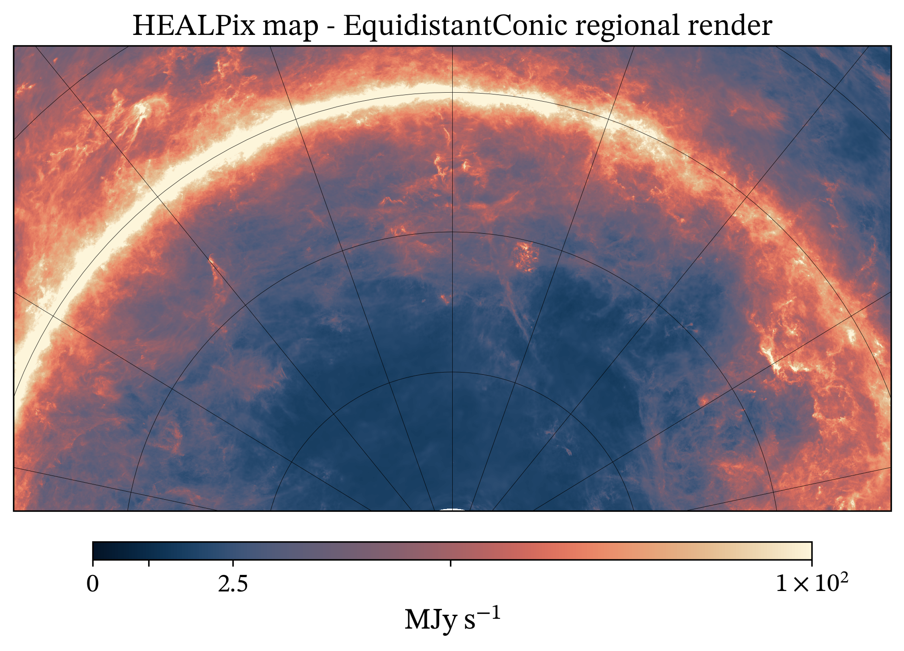
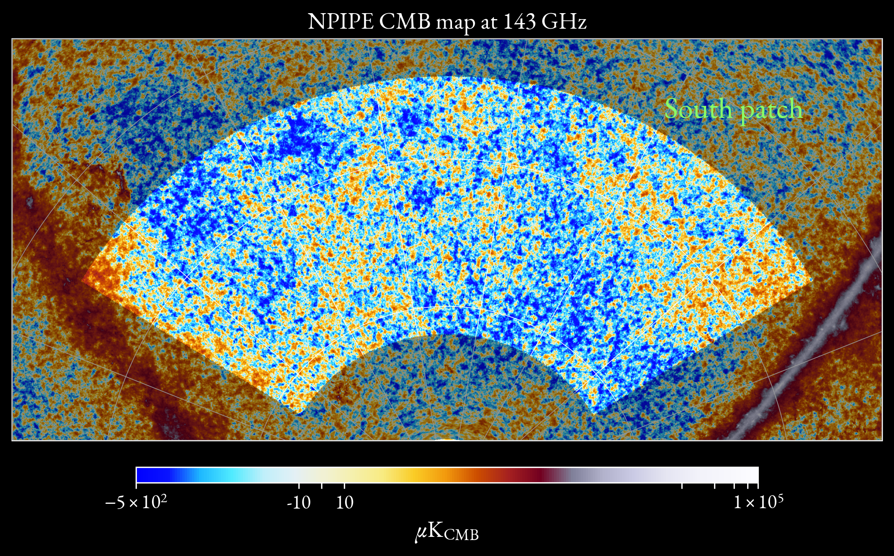
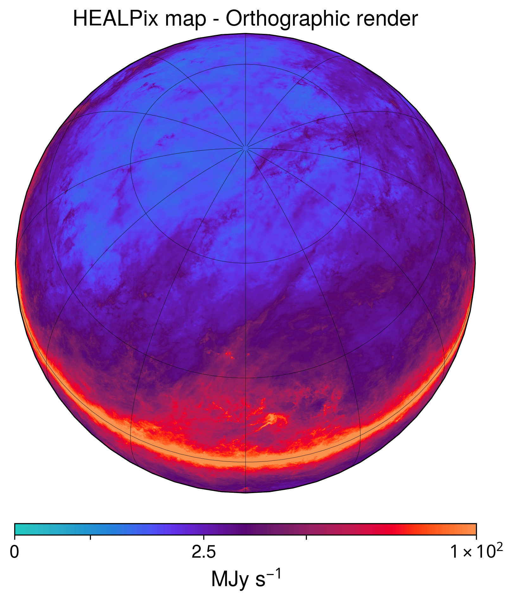
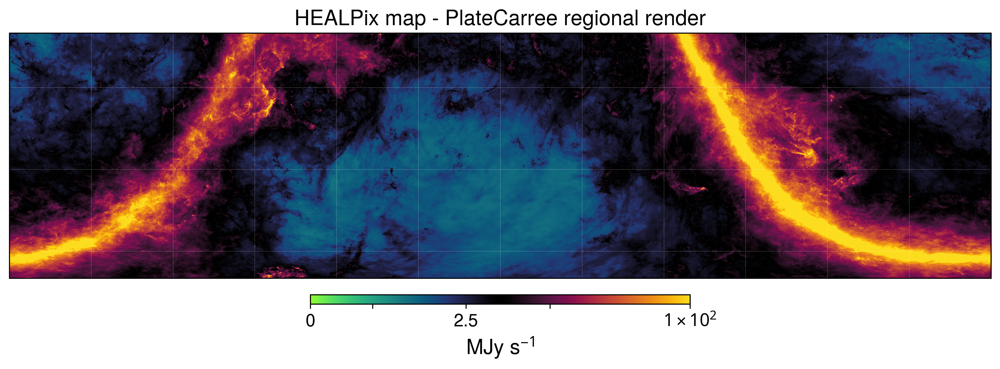
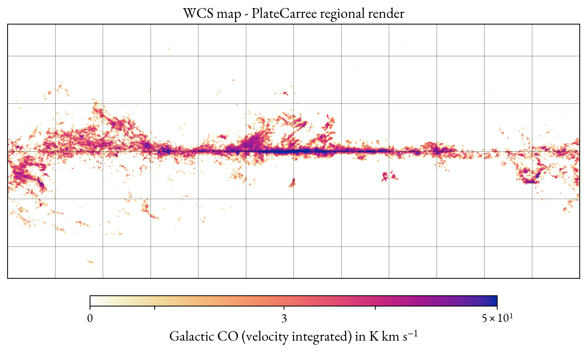
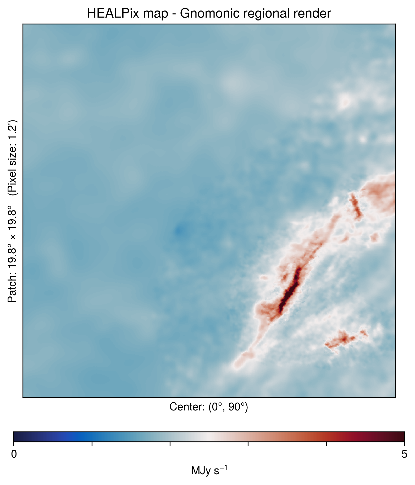
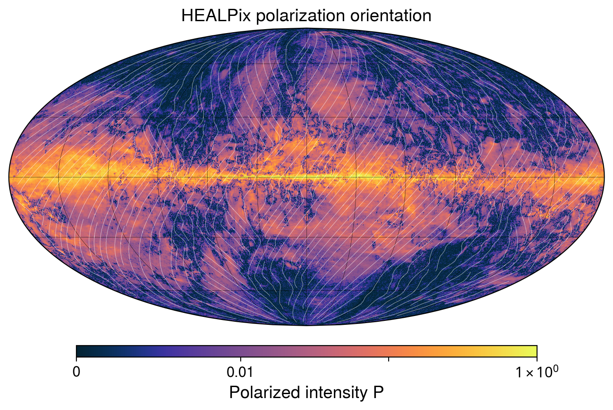
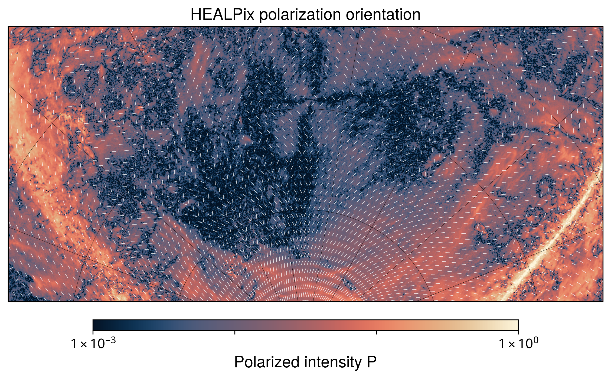

Usage
=====

This page follows the examples in ``notebooks/skyplot_package_test.ipynb``.
They render a HEALPix dust map, optionally overlay a Galactic-plane mask, and
show the data with each available sky projection. The notebook also includes
a WCS-backed map, polarization vectors, and a CMB map using ``PlanckLogNorm``.

Set up the map
----------------

Import the plotting functions and inspect the available projections and
sampling presets. The notebook uses ``resolution="high"`` for several
figures and ``"medium"`` for Mollweide and vector plots. Use ``"low"`` for
quicker previews.

.. code-block:: python

   from pathlib import Path

   import matplotlib.colors as mpc
   import healpy as hp
   import numpy as np

   from skyplot import (
       AVAILABLE_PROJECTIONS,
       FONT_SIZE_PRESETS,
       PlanckLogNorm,
       RESOLUTION_PRESETS,
       equidistantconic,
       gnomonic,
       mollweide,
       orthographic,
       platecarree,
       set_theme,
   )

   print("Available projections:", AVAILABLE_PROJECTIONS)
   print("Resolution presets:", RESOLUTION_PRESETS)
   print("Base font sizes (points):", FONT_SIZE_PRESETS)

Importing SkyPlot selects the ``modern`` theme. The examples call
``set_theme`` where the notebook changes themes: ``classic`` for the WCS map,
``academic`` for Equidistant Conic, ``modern`` for the other dust-map views,
and ``classic_dark`` for the CMB map. Each plot passes ``cmap`` explicitly,
so the theme controls the fonts, background, gridlines, and other Matplotlib
settings. See :doc:`themes` for theme defaults and customization.

``PlanckLogNorm()`` provides Planck-style symmetric asinh/logarithmic
normalization. It derives unset limits from the plotted map; pass explicit
``vmin`` and ``vmax`` when a fixed scale is needed. ``linthresh`` sets the
scale of the linear region around zero. The CMB example below uses a fixed
range of ``-500`` to ``100000`` with ``linthresh=10``.

Colorbars label only the displayed color limits by default. Other major ticks
remain visible without labels, and minor ticks are hidden. With
``SymLogNorm``, ``norm="symlog"``, or ``PlanckLogNorm``, the visible
``-linthresh`` and ``+linthresh`` boundaries are labeled too. Pass
``colorbar_kwargs={...}`` for Matplotlib colorbar options such as ``ticks``,
``format``, ``label``, or ``orientation``. Explicit ``ticks`` or ``format``
use Matplotlib's labels in place of SkyPlot's default labels.

For a translucent scalar layer in any projection, call the same plotting
function with ``plot_mode="map"``, an existing ``ax``, and ``alpha < 1``.
The layer is rendered as one image to keep its opacity uniform. Mollweide,
Orthographic, Plate Carrée, and Equidistant Conic scalar maps also use a
warped image when opaque. Set ``mesh_method="mesh"`` to use Cartopy's pixel
mesh for an opaque map. ``pcolormesh_kwargs`` is ignored unless mesh mode is
selected. Set opacity and drawing order with the top-level ``alpha`` and
``zorder`` arguments. Gnomonic maps already use an image.

Plotting uses nearest-pixel sampling by default (``interpolate=False``) and
makes missing, non-finite, or sentinel-valued samples transparent
(``badcolor=None``). Pass ``interpolate=True`` or a color such as
``badcolor="grey"`` when a different rendering is desired.

For ``platecarree`` and ``equidistantconic``, pass ``extent="auto"`` to
derive the geographic extent from a WCS-backed 2D map. For a HEALPix map,
``extent="auto"`` selects the global extent. Omitting ``extent`` (or passing
``None``) keeps the default global view; pass
``extent=(lon_min, lon_max, lat_min, lat_max)`` for explicit bounds. For these
regional projections, the grid samples the entire projected viewport. A conic
view can show positions outside the requested geographic extent; those visible
positions are sampled too.

Load a 1D HEALPix FITS map by setting ``map_path`` to a local file. The map
must contain the field selected by ``field``; the notebook uses the first
field, ``field=0``.

.. code-block:: python

   # Replace this with the path to your HEALPix FITS map.
   map_path = Path("path/to/your_healpix_map.fits")

   if not map_path.exists():
       raise FileNotFoundError(f"Set map_path to an existing file: {map_path}")

   hp_map = hp.read_map(map_path, field=0)
   print("Map loaded:", map_path)
   print("npix:", hp_map.size, "nside:", hp.get_nside(hp_map))
   print("dtype:", hp_map.dtype)

Mollweide full-sky view
-----------------------

This full-sky view uses a symmetric-logarithmic scale to retain both faint and
bright map structure. The second call layers the optional mask onto the axes
created by the first call.

Mask overlay (optional)
~~~~~~~~~~~~~~~~~~~~~~~

Load a Galactic-plane mask only if it is needed for this view. Zero-valued
pixels are painted as a translucent overlay. Select this layer solely with
``plot_mode="overlay_mask"``; scalar color options are ignored in this mode.

.. code-block:: python

   mask_path = Path("path/to/your_mask.fits")
   mask = hp.read_map(mask_path, field=1)

.. code-block:: python

   fig = mollweide(
       hp_map,
       resolution="medium",
       cmap="sunburst",
       norm="symlog",
       vmin=0.0,
       vmax=100.0,
       badcolor=None,
       title="HEALPix map - Mollweide render",
       colorbar_title=r"MJy s${}^{-1}$",
   )

   mollweide(
       mask,
       resolution="medium",
       ax=fig.ax,
       badcolor=None,
       plot_mode="overlay_mask",
       alpha=0.4,
       show_gridlines=False,
       overlay_color="k",
   )

   The notebook's Mollweide full-sky rendering.

Equidistant Conic regional view
-------------------------------

Use ``extent`` to select a region and set the conic's center and standard
parallels through ``projection_kwargs``. The notebook selects the ``academic``
theme for this plot, then uses the ``lipari`` colormap and a ``SymLogNorm``
to show the dust map's range.

.. code-block:: python

   set_theme("academic")
   equidistantconic(
       hp_map,
       projection_kwargs={
           "central_longitude": -60.0,
           "central_latitude": -30.0,
           "standard_parallels": (-70.0, -15.0),
       },
       extent=(-150.0, 30.0, -80.0, 10.0),
       resolution="high",
       cmap="lipari",
       norm=mpc.SymLogNorm(
           linthresh=2.5, linscale=0.35, vmin=0.0, vmax=100.0
       ),
       title="HEALPix map - EquidistantConic regional render",
       colorbar_title=r"MJy s${}^{-1}$",
   )

   The notebook's regional Equidistant Conic rendering.

PlanckLogNorm CMB view
----------------------

The notebook selects ``classic_dark`` for this NPIPE 143 GHz map and passes
``planck_log`` as the colormap. Theme examples and dark mode customization
are on :doc:`themes`. The map is stored in Galactic coordinates and displayed
on an ICRS grid. The mask is supplied on the same grid as the display.

``PlanckLogNorm`` stretches values near zero while retaining the large
positive range. The notebook sets ``vmin=-500``, ``vmax=100000``, and
``linthresh=10`` inside the norm. Do not also pass top-level ``vmin`` or
``vmax``. With no limits, the norm takes them from the plotted map.

The notebook loads the NPIPE temperature field, subtracts the CMB dipole and
quadrupole, converts to microkelvin, and resamples a southern mask before
plotting. Replace the paths below with your data files.

.. code-block:: python

   npipe_143 = hp.read_map("path/to/npipe_143_map.fits", field=[0, 1, 2])
   nside = hp.get_nside(npipe_143)
   dipole = hp.ud_grade(hp.read_map("path/to/cmb_dipole.fits"), nside)
   quadrupole = hp.ud_grade(hp.read_map("path/to/cmb_quadrupole.fits"), nside)
   npipe_143[0] -= dipole + quadrupole
   npipe_143 *= 1e6

   mask = hp.read_map("path/to/south_mask.fits")
   mask = hp.ud_grade(mask, nside_out=nside)

   set_theme("classic_dark")
   fig = equidistantconic(
       npipe_143[0],
       projection_kwargs={
           "central_longitude": 15.0,
           "central_latitude": -45.0,
           "standard_parallels": (-70.0, -15.0),
       },
       extent=(-90.0, 120.0, -65.0, -5.0),
       coordinate_transform=("galactic", "icrs"),
       cmap="planck_log",
       norm=PlanckLogNorm(linthresh=10.0, vmin=-500.0, vmax=100000.0),
       title="NPIPE CMB map at 143 GHz",
       gridline_kwargs={"linewidth": 0.4, "color": "w", "linestyle": "-"},
       colorbar_title=r"$\mu$K${}_{\rm CMB}$",
   )

   equidistantconic(
       mask,
       plot_mode="overlay_mask",
       overlay_color="k",
       alpha=0.4,
       ax=fig.ax,
   )

   The NPIPE map with ``PlanckLogNorm`` and the notebook's ``classic_dark`` theme.

Orthographic view
-----------------

An Orthographic projection presents the sky as viewed from outside a globe.
Choose the displayed hemisphere with ``central_longitude`` and
``central_latitude``. The notebook returns to the ``modern`` theme here.

.. code-block:: python

   set_theme("modern")
   orthographic(
       hp_map,
       resolution="high",
       projection_kwargs={
           "central_longitude": 0.0,
           "central_latitude": 60.0,
           "azimuth": 0.0,
       },
       cmap="guppy_r",
       norm=mpc.SymLogNorm(
           linthresh=2.5, linscale=1.0, vmin=0.0, vmax=100.0
       ),
       badcolor=None,
       title="HEALPix map - Orthographic render",
       colorbar_title=r"MJy s${}^{-1}$",
   )

   The notebook's Orthographic rendering centered at longitude 0 and latitude 60 degrees.

Plate Carree coordinate transform
---------------------------------

This example displays a Galactic map on an ICRS/equatorial longitude-latitude
grid. ``coordinate_transform`` is ordered ``(source_frame, display_frame)``;
use Astropy frame strings such as ``"galactic"``, ``"icrs"``, and
``"geocentrictrueecliptic"``.

.. code-block:: python

   platecarree(
       hp_map,
       coordinate_transform=("galactic", "icrs"),
       extent=(-180.0, 180.0, -70.0, 20.0),
       resolution="high",
       cmap="wildfire",
       norm=mpc.SymLogNorm(
           linthresh=2.5, linscale=1.0, vmin=0.0, vmax=100.0
       ),
       badcolor=None,
       gridline_kwargs={"linewidth": 0.2, "color": "w", "linestyle": ":"},
       title="HEALPix map - PlateCarree regional render",
       figsize=(12, 4),
       colorbar_title=r"MJy s${}^{-1}$",
   )

   The notebook's Plate Carree rendering after transforming Galactic coordinates to ICRS.

WCS-backed maps
---------------

SkyPlot also accepts a two-dimensional array with an Astropy WCS. The
notebook example starts from a three-axis CO cube whose WCS has the following
world-axis order. It selects the ``classic`` theme and overrides its default
colormap with ``cet_l_worb``.

.. code-block:: text

   0: VOPT       (velocity)
   1: GLON-CAR   (Galactic longitude)
   2: GLAT-CAR   (Galactic latitude)

The corresponding FITS pixel lengths are ``(146, 1441, 677)``. FITS data are
presented to NumPy in reverse axis order, so the cube has shape
``(677, 1441, 146)``. Integrating its last (velocity) axis produces the
two-dimensional map shape ``(677, 1441) = (GLAT, GLON)``.

.. code-block:: python

   from astropy.io import fits
   from astropy.wcs import WCS

   with fits.open("path/to/co_cube.fits") as hdulist:
       hdu = hdulist[0]
       wcs = WCS(hdu.header)
       data = hdu.data

   data = np.nan_to_num(data, nan=0.0)
   vel_inted_data = np.trapezoid(data, dx=0.65019, axis=2)
   assert vel_inted_data.shape == (677, 1441)  # (GLAT, GLON)

Pass the zero-based WCS *world-axis* indices, rather than NumPy array-axis
indices, through ``world_axis_mapping``. Here ``(1, 2)`` selects
``(GLON-CAR, GLAT-CAR)``; the retained velocity world axis is evaluated at its
reference value. If the non-spatial and sky axes are coupled, slice both the
WCS and cube to the desired plane before plotting.

.. code-block:: python

   set_theme("classic")
   platecarree(
       vel_inted_data,
       extent=(-180.0, 180.0, -80.0, 80.0),
       cmap="cet_l_worb",
       wcs=wcs,
       world_axis_mapping=(1, 2),
       badcolor=None,
       norm=mpc.SymLogNorm(linthresh=3.0, linscale=1.0, vmin=0.0, vmax=50.0),
       title="WCS map - PlateCarree regional render",
       colorbar_title=r"Galactic CO (velocity integrated) in K km s${}^{-1}$",
   )

The source WCS longitude pixels span ``-60°`` to ``300°`` and therefore have
a native seam at ``-60°/300°``. SkyPlot samples those native coordinates onto
the uniform displayed ``[-180°, 180°]`` longitude grid, including equivalent
360-degree longitudes as needed. The output is consequently centered at
``(0°, 0°)`` because of its ``extent``; ``central_longitude`` is not inferred
from the WCS. This differs from the source-array midpoint: the middle GLON
column is at ``120°``, while GLON ``0°`` is column 240. The array center and
the displayed map center therefore should not be expected to coincide.

   WCS-backed Galactic CO map sampled onto the standard Plate Carree display grid.

Gnomonic detail view
--------------------

Gnomonic is intended for a small tangent-plane region. ``center`` gives the
longitude and latitude in degrees, while ``xsize``, ``ysize``, and
``pixel_size_arcmin`` set the output sampling. The x-axis records the plot
center; the y-axis records patch dimensions and pixel size in arcminutes.
Optional curved, unlabeled longitude/latitude graticules can be enabled with
``show_gridlines=True`` and styled with ``gridline_kwargs``. The notebook
keeps gridlines off and uses ``1.2`` arcminutes per pixel.

.. code-block:: python

   set_theme("modern")
   gnomonic(
       hp_map,
       center=(0.0, 90.0),
       xsize=1000,
       ysize=1000,
       pixel_size_arcmin=1.2,
       cmap="balance",
       vmin=0.0,
       vmax=5.0,
       title="HEALPix map - Gnomonic regional render",
       figsize=(5.5, 6.5),
       colorbar_title=r"MJy s${}^{-1}$",
   )

   The notebook's Gnomonic detail view centered at longitude 0 and latitude 90 degrees.

Vector field visualization
--------------------------

``plot_mode="vector_field"`` adds a transparent streamplot or quiver artist
to an existing map axes. Render the scalar magnitude in a separate ordinary
map call first, then pass ``ax=fig.ax`` for the overlay. Scalar map
arguments (``cmap``, ``vmin``, ``vmax``, and ``norm``) are ignored by the
overlay; configure the artist through ``vector_kwargs``.

For dust polarization, the first and second input maps are the **east** and
**north** components of the director field, not the input Stokes ``U`` map.
The following notebook-derived snippet follows the **HEALPix/COSMO**
polarization convention:

.. code-block:: python

   hp_qu_map = hp.read_map("path/to/stokes_qu_map.fits", field=None)
   Q_stokes, U_stokes = hp_qu_map[:2]
   P = np.hypot(Q_stokes, U_stokes)
   psi = 0.5 * np.arctan2(U_stokes, Q_stokes)
   east_component = np.sin(psi)       # HEALPix e_phi
   north_component = -np.cos(psi)     # negative HEALPix e_theta

   set_theme("modern")
   vector_fig = mollweide(
       P,
       cmap="thermal",
       norm=mpc.SymLogNorm(linthresh=0.01, linscale=1.0, vmin=0.0, vmax=1.0),
       colorbar_title="Polarized intensity P",
       resolution="medium",
       title="HEALPix polarization orientation",
   )

.. warning::

   Polarization conventions require care. The component conversion above is
   for HEALPix/COSMO maps. IAU-convention products use the opposite Stokes
   ``U`` sign, so convert their ``U`` map before calculating ``psi``. Always
   confirm the convention recorded by the data product.

Streamplot
~~~~~~~~~~

Use streamplot for continuous paths through the direction field. ``density``
controls the number of paths; ``linewidth``, ``arrowsize``, and ``arrowstyle``
control their appearance.

.. code-block:: python

   mollweide(
       (east_component, north_component),
       ax=vector_fig.ax,
       plot_mode="vector_field",
       vector_kwargs={
           "method": "streamplot",
           "color": "white",
           "linewidth": 0.3,
           "arrowstyle": "-",
           "arrowsize": 0.5,
           "density": 3.,
       },
       resolution="medium",
       alpha=0.7,
   )

   Streamplot representation of the polarization direction field.

Quiver
~~~~~~

Use quiver for discrete vectors when controlled sampling is preferable to
continuous paths. The notebook creates a separate Equidistant Conic magnitude
map in ICRS coordinates and overlays Galactic polarization directions on it.
``LogNorm`` emphasizes the faint polarized signal; the vector options set
quiver density and remove arrowheads for this orientation field.

.. code-block:: python

   conic_projection = {
       "central_longitude": 15.0,
       "central_latitude": -45.0,
       "standard_parallels": (-70.0, -15.0),
   }
   conic_extent = (-90.0, 120.0, -65.0, -5.0)

   vector_fig = equidistantconic(
       P,
       projection_kwargs=conic_projection,
       extent=conic_extent,
       coordinate_transform=("galactic", "icrs"),
       cmap="lipari",
       norm=mpc.LogNorm(vmin=1e-3, vmax=1.0),
       colorbar_title="Polarized intensity P",
       title="HEALPix polarization orientation",
   )
   equidistantconic(
       (east_component, north_component),
       projection_kwargs=conic_projection,
       extent=conic_extent,
       coordinate_transform=("galactic", "icrs"),
       ax=vector_fig.ax,
       plot_mode="vector_field",
       vector_kwargs={
           "method": "quiver",
           "color": "white",
           "scale": 40.0,
           "scale_units": "height",
           "width": 0.005,
           "headwidth": 0.0,
           "minshaft": 2.5,
           "alpha": 0.8,
       },
   )

   Quiver representation of the polarization direction field.

Polarization orientation has no intrinsic arrow direction. For a headless
streamline representation, use
``vector_kwargs={"method": "streamplot", "arrowstyle": "-"}``.

Saving a figure
---------------

Each plotting function returns a ``PlotResult``. Its ``figure`` is the
Matplotlib figure and its ``ax`` is the map axes. In a notebook, a bare plot
call displays one image through Matplotlib's inline backend. The figure stays
open, and ``fig.figure.savefig(...)`` saves that specific plot. Pass Matplotlib
export options such as ``dpi`` and ``bbox_inches`` to ``savefig``. Use
``bbox_inches="tight"`` when exporting titles or other artists near the figure
edge; ``pad_inches`` only applies with that option.

.. code-block:: python

   fig = mollweide(hp_map, cmap="sunburst", norm="symlog", vmin=0, vmax=100)
   fig.figure.savefig("simulated_sky.png", dpi=300, bbox_inches="tight", pad_inches=0.2)

   # Add another layer to the same map.
   mollweide(mask, ax=fig.ax, plot_mode="overlay_mask", alpha=0.35)
   fig.figure.savefig("sky_with_mask.png", bbox_inches="tight", pad_inches=0.2)
